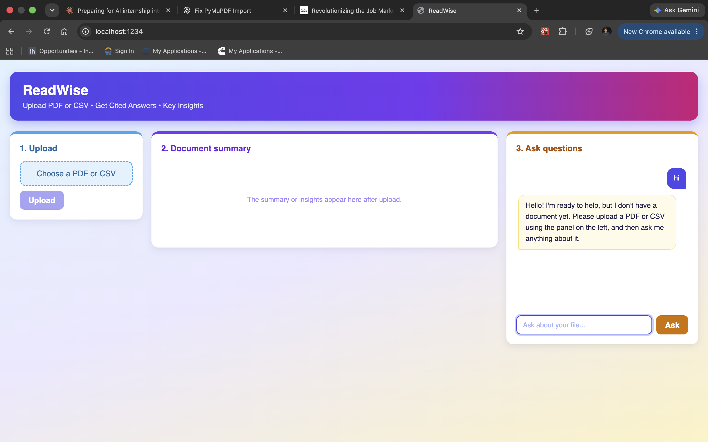
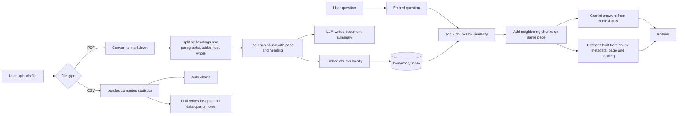
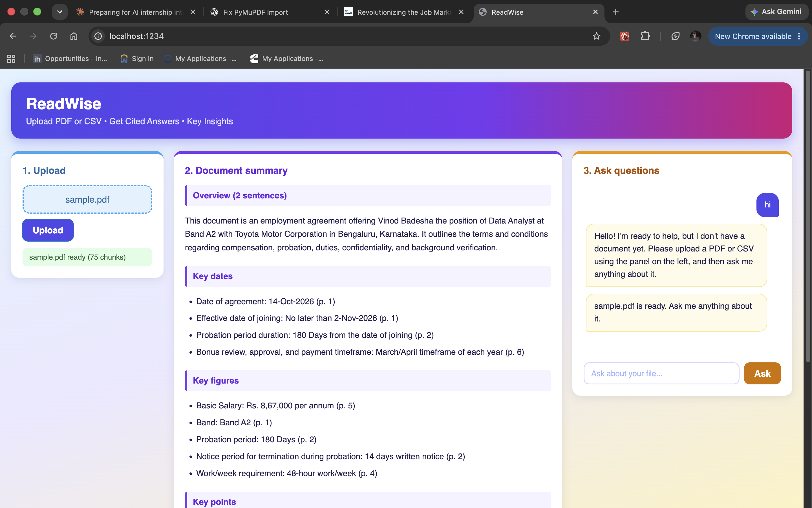

# 📄 ReadWise: RAG Document Q&A with CSV Insights

Upload a PDF or CSV. Get **cited answers** from PDFs (page and section) and **automatic insights, data-quality checks and charts** from CSVs. Built with FastAPI, React and the free Gemini API tier, so it runs at zero cost.




---

## ✨ What this project demonstrates

- **RAG pipeline:** PDF → markdown → structure-aware chunks → local embeddings → retrieval → LLM answer
- **Verifiable citations:** page and section heading are built in code from chunk metadata, so the model cannot invent them
- **Table-aware parsing:** PDFs converted to markdown so tables keep their structure
- **Context-aware retrieval:** matched chunks plus their neighbors on the same page
- **Hallucination control:** answers only from the document, otherwise "Not found in the document"
- **CSV insights:** pandas computes the statistics; the LLM only explains them
- **Dashboard UI:** upload on the left, summary or insights in the middle, chat on the right

---

## 🧱 Tech Stack

| Component | Technology |
| --- | --- |
| LLM | Google Gemini API (free tier) |
| Embeddings | `sentence-transformers/all-MiniLM-L6-v2` (runs locally) |
| PDF parsing | PyMuPDF / `pymupdf4llm` |
| Data analysis | pandas, matplotlib |
| Backend | FastAPI |
| Frontend | React (bundled with Parcel) |

---

## 📂 Project structure

```
[repo-name]/
├── main.py              # FastAPI app: /upload, /ask
├── ingest.py            # PDF → markdown → chunks with page + heading
├── retrieve.py          # embeddings + similarity search
├── answer.py            # prompting, neighbor expansion, citations, summary
├── csv_insights.py      # pandas stats, charts, LLM insights
├── requirements.txt
├── assets/              # screenshots
└── frontend/
    ├── index.html
    ├── index.jsx
    ├── App.jsx          # three-panel dashboard
    ├── styles.css
    └── .proxyrc.json    # forwards API calls to FastAPI
```

---

## ⚙️ Setup

1. **Clone the repo**
```
   git clone https://github.com/vinodbadesha/[repo-name].git
   cd [repo-name]
```
2. **Create a virtual environment and install dependencies**
```
   python -m venv venv
   source venv/bin/activate
   pip install -r requirements.txt
```
3. **Set your free Gemini API key** (get one at aistudio.google.com)
```
   export GEMINI_API_KEY="your-key"
```
4. **Install the frontend**
```
   cd frontend
   npm install
```

---

## 🚀 Running locally

Terminal 1 (project root):
```
uvicorn main:app --reload
```
Terminal 2:
```
cd frontend
npm start
```
Open http://localhost:1234

---

## 💡 How it works

1. **Ingestion:** the PDF is converted to markdown and split on headings and paragraphs. Tables stay whole. Each chunk is tagged with its page and section heading.
2. **Retrieval:** chunks are embedded locally and the top 3 by cosine similarity are selected, plus the neighboring chunks on the same page.
3. **Generation:** the LLM answers from that context only, and treats the document text as untrusted.
4. **Citations:** page and heading come from chunk metadata, not from the model.
5. **CSV:** pandas builds statistics (nulls, duplicates, top categories). Only this summary goes to the LLM.





---

## 🛠️ Problems I hit and how I fixed them

- **Chunks cut mid-sentence:** moved from fixed character splits to heading and paragraph-aware chunks, then added neighbor expansion
- **Tables lost their structure:** switched to markdown conversion
- **LLM flagged blank cancellation fields as data-quality issues:** it only saw numbers, so I added what blanks mean to the prompt
- **LLMs miscount:** all numbers are computed in pandas, and the LLM only writes commentary
- **Free-tier API errors (503 overload, retired models):** added retry with backoff and listed available models instead of guessing names
- **Stale state after reload:** the server kept the old file in memory, so the UI now decides whether a file is loaded

---

## 🧪 Evaluation

I tested the app with [N] questions across a public PDF and a 150,000-row ride-booking CSV, checking each answer against the source.

| Type | Asked | Correct | Failed |
| --- | --- | --- | --- |
| PDF facts and tables | [10] | [6] | [3] |
| CSV counts and distributions | [5] | [4] | [1] |

### What worked
- Fact lookups (dates, role, company, probation period) returned correct answers with page citations
- CSV counts, percentages and category distributions matched the data
- The app declined to answer when the data was insufficient (for example, peak hours, when no hourly breakdown was available)

### What failed, and why
- **Wording sensitivity:** one question returned "Not found", but the same question with an abbreviation added returned the right figure. Retrieval depends on the wording matching the document's wording.
- **Overview questions:** "what does this document summarize?" returned "Not found". Three retrieved chunks cannot represent a whole document.
- **Partial answer:** a question about an appendix found the heading but missed its contents, the same retrieval weakness.
- **Filtered calculation on CSV:** asked for revenue from completed rides only, the model reported an unfiltered total. The chat only sees summary statistics, so it cannot filter rows. [keep only if verified against the CSV]

### What I would do next
- Hybrid retrieval (keyword plus embeddings) and a larger k to reduce wording sensitivity
- Pass the document summary to the model for overview questions
- Let the model request pandas operations from a safe whitelist for filtered CSV questions, instead of answering from summary statistics

---

## 🔎 Example questions to try

- Give a short summary of this document.
- What is the effective date mentioned in the document?
- How much is Dearness Allowance (DA)?
- (CSV) Which booking status is most common?
- (CSV) What data quality issues do you see?

---

## 📌 Notes & Limitations

- One file at a time, held in memory (single-user demo)
- Scanned PDFs are not supported (no OCR)
- Citations list every section shown to the model, including neighbor chunks
- CSV chat answers only from summary statistics, not arbitrary queries
- The document summary covers the first 30,000 characters
- Free API tier: rate limits and occasional 503 errors